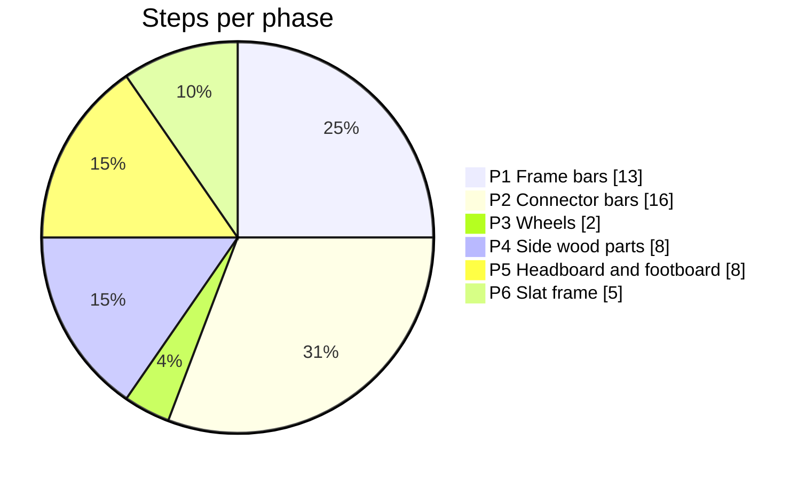
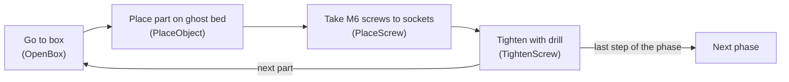
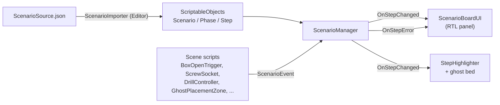
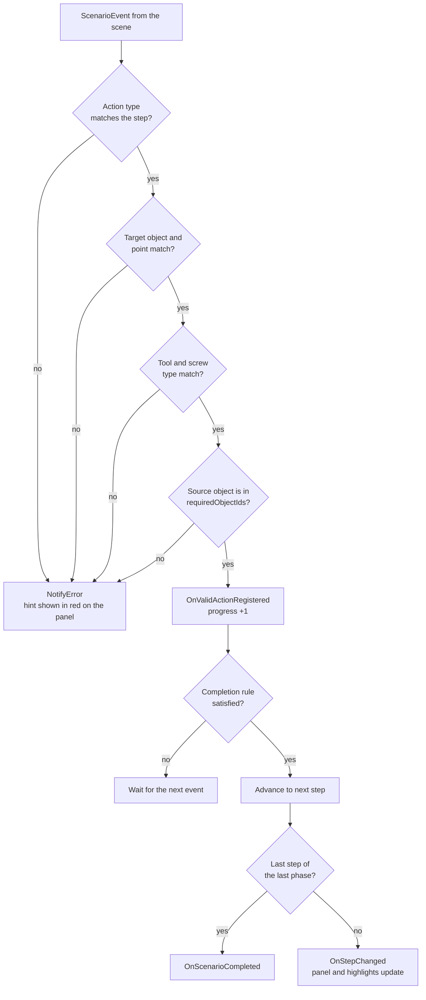
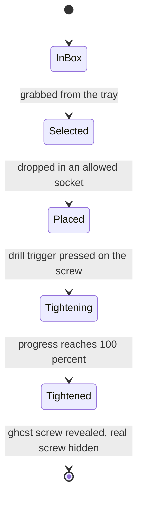

# 🛏️ Med-Assemble | مد-اسمبل

**شبیه‌ساز واقعیت مجازی برای آموزش مونتاژ تخت بیمارستانی**

پروژه‌ی تیم ⁦Vram⁩

> **English summary.** Med-Assemble is a VR training simulator for assembling a hospital bed, built in Unity (C#) with XR Interaction Toolkit for Meta Quest. The trainee works through 6 phases and 52 steps: picking parts from boxes, placing them on a transparent "ghost" bed, placing M6 screws and tightening them with a power drill (analog trigger, haptics, motor sound). A wrong action gets a hint, never the answer. The whole scenario lives in one JSON file that is imported into ScriptableObjects, so steps can be changed without touching code. All instructions, error messages and voice-over are in Persian (RTL). The project is under active development. This repository is a showcase only: the full project is not open source.

<!--
  ویدئوی معرفی: وقتی لینک آماده شد، این بلوک را از حالت کامنت دربیاورید
  و VIDEO_URL را عوض کنید.

## 🎬 ویدئوی معرفی

-->

## 🎯 معرفی

مونتاژ تخت بیمارستانی معمولاً حضوری و با قطعات واقعی آموزش داده می‌شود. یعنی مربی لازم است، قطعه‌ها کم‌کم فرسوده می‌شوند و هر اشتباه هزینه دارد. ما همین آموزش را به واقعیت مجازی آوردیم.

با هدست ⁦Meta Quest⁩ وارد یک اتاق می‌شوید، قطعه‌ها را برمی‌دارید، روی تخت می‌گذارید، پیچ‌ها را جا می‌اندازید و با بکس برقی سفت می‌کنید. پنل روی دیوار هر مرحله را توضیح می‌دهد و کارتان را همان لحظه چک می‌کند. اگر اشتباه کنید جواب درست را نمی‌گوید و فقط یک راهنمایی می‌دهد تا خودتان پیدایش کنید.

برای تکنسین‌ها و کارگران صنعتی، بیمارستان‌ها و شرکت‌هایی که تجهیزات پزشکی تولید می‌کنند.

> ⁦Vram⁩ مخفف ⁦Virtual Reality Assembly & Maintenance⁩ است و از اسم ⁦Virtual RAM⁩ الهام گرفته.

---

## 🎞️ در عمل ببینید

<table align="center">
  <tr>
    <td align="center"> برداشتن قطعه از جعبه و گذاشتن در جای شفافش</td>
    <td align="center"> سفت‌کردن پیچ‌ها با بکس برقی</td>
  </tr>
  <tr>
    <td align="center"> بکس برقی و کمربند ابزار</td>
    <td align="center"> اجرای واقعی روی ⁦Meta Quest⁩</td>
  </tr>
</table>

---

## ✨ قابلیت‌ها

- **۶ فاز و ۵۲ مرحله.** هر مرحله فقط بعد از انجام درست مرحله‌ی قبل باز می‌شود.
- **پنل راهنما و گوینده.** هر مرحله هم نوشته می‌شود و هم خوانده می‌شود. برای کارهای تکراری (مثلاً ۴ پیچ) نوار پیشرفت هم هست.
- **هایلایت.** هرچه در مرحله‌ی فعلی لازم است رنگی می‌شود.
- **تخت شفاف.** وسط اتاق یک نسخه‌ی شفاف از تخت هست که جای هر قطعه و پیچ را نشان می‌دهد. هرچه درست نصب شود، همان‌جا واقعی می‌شود.
- **پیچ‌های چندنوعی.** هر مرحله نوع و جای مشخص پیچ را می‌خواهد.
- **بکس برقی.** با ⁦Trigger⁩ روشن می‌شود، با فشار انگشت لرزش و صدایش تغییر می‌کند و پیچ واقعاً می‌چرخد و جلو می‌رود.
- **کمربند ابزار.** بکس و جعبه‌ی پیچ روی کمربندی هستند که همراه شما حرکت می‌کند.
- **حرکت آزاد.** راه رفتن یا تلپورت.
- **همه‌چیز فارسی.** متن‌ها، پیام‌ها و گوینده.

### 🎨 معنی رنگ‌ها

| رنگ | معنی |
|:--:|---|
| 🟡 | قطعه‌ای که باید بردارید |
| 🔵 | جعبه یا جایی که باید بروید |
| 🟢 | سینی پیچِ درست |
| 🩵 | جای نصب روی تخت شفاف |

---

## 🖼️ نمایی از محیط

<table align="center">
  <tr>
    <td align="center"> پنل راهنما: نام فاز، شماره‌ی مرحله و دستور</td>
    <td align="center"> تخت شفاف: جای پیچ‌ها و مهره‌ها مشخص است</td>
  </tr>
  <tr>
    <td align="center"> کمربند ابزار: جعبه‌ی پیچ و بکس برقی</td>
    <td align="center"> سفت‌کردن پیچ‌ها با بکس روی تخت شفاف</td>
  </tr>
</table>

---

## 🎮 چه کارهایی انجام می‌دهید؟

| کار | توضیح |
|---|---|
| **رفتن به جعبه** | جعبه‌ای که باید بروید آبی می‌شود و با نزدیک شدن، مرحله‌ی بعد باز می‌شود. قطعه‌ها در جعبه‌ی ۱ و جعبه‌ی ۲ هستند. |
| **جمع‌کردن پیچ‌ها** | چند پیچ ⁦M6⁩ را از سینی سبز روی میز کار برمی‌دارید و داخل جعبه‌ی پیچ کنار کمربندتان می‌ریزید. |
| **گذاشتن بکس کنار کمربند** | بکس را کنار کمربند می‌گذارید. یک نمای شفاف جای نشستنش را نشان می‌دهد و با رها کردن، خودش جا می‌افتد. |
| **نصب میله‌ها** | میله‌های فریم و چهار میله‌ی رابط را از جعبه برمی‌دارید و در جای شفافشان روی تخت می‌گذارید. |
| **نصب چرخ‌ها** | چهار چرخ، یکی‌یکی، زیر پایه‌های تخت. |
| **نصب قطعات چوبی** | قطعه‌های کناری، تاج تخت، قطعه‌ی جلویی و آخر از همه لت تخت. |
| **گذاشتن پیچ** | پیچ ⁦M6⁩ را در جای هایلایت‌شده می‌گذارید. هر مرحله فقط همان جاها را قبول می‌کند. |
| **سفت‌کردن با بکس** | نوک بکس را روی پیچ می‌گذارید و ⁦Trigger⁩ را می‌فشارید. تا همه‌ی پیچ‌های آن مرحله جا نیفتاده باشند، بکس کار نمی‌کند. |
| **پایان** | بعد از سفت‌شدن آخرین پیچ‌های لت، پیام تبریک نشان داده می‌شود. |

 پیچ ⁦M6⁩ روی میز کار، کنار تخت شفاف

---

## 🛏️ فازها

| فاز | چه ساخته می‌شود | مراحل |
|:--:|---|:--:|
| ۱ | فریم تخت (جلو، راست، چپ و تاج) | ۱۳ |
| ۲ | چهار میله‌ی رابط | ۱۶ |
| ۳ | چرخ‌ها | ۲ |
| ۴ | قطعات چوبی کناری | ۸ |
| ۵ | تاج و قطعه‌ی جلویی | ۸ |
| ۶ | لت تخت | ۵ |

سهم هر فاز از کل ۵۲ مرحله:

بیشتر فازها یک الگوی تکرارشونده دارند: می‌روید سراغ جعبه، قطعه را روی تخت شفاف می‌گذارید، پیچ‌ها را جا می‌اندازید و با بکس سفت می‌کنید. بعد یا سراغ قطعه‌ی بعدی می‌روید یا فاز تمام می‌شود.

---

## 🚨 خطاها

وقتی اشتباه می‌کنید، متن دستور چند ثانیه قرمز می‌شود و پیام راهنما را نشان می‌دهد، صدای خطا پخش می‌شود و بعد دستور اصلی برمی‌گردد. پیام‌ها عمداً جواب نمی‌دهند و فقط جهت را نشان می‌دهند.

<table align="center">
  <tr>
    <td align="center"> برداشتن پیچ از نوع اشتباه</td>
    <td align="center"> گذاشتن پیچ درست در جای اشتباه</td>
  </tr>
</table>

| خطا | پیام |
|---|---|
| پیچ از نوع اشتباه | «نوع پیچ اشتباه است! فقط پیچ ⁦M6⁩ را بردارید.» |
| پیچ درست، جای اشتباه | «پیچ را فقط در محل‌های هایلایت‌شده‌ی اتصال ... قرار دهید.» |
| قطعه‌ای که نوبتش نیست | «این قطعه الان مورد نیاز نیست.» (قطعه در دستتان نمی‌ماند) |
| سفت‌کردن زودتر از موعد | «ابتدا باید همه پیچ‌های این مرحله را در جای خود قرار دهید.» |
| پیچ اشتباه در جعبه‌ی کمربند | «فقط پیچ‌های ⁦M6⁩ را داخل جعبه کمربند قرار دهید.» |

---

## 🕹️ کنترل‌ها

| کار | چطور |
|---|---|
| گرفتن قطعه | دست را نزدیک ببرید یا با اشعه نشانه بگیرید و دکمه‌ی گرفتن را بزنید |
| روشن کردن بکس | ⁦Trigger⁩ همان دستی که بکس را گرفته |
| گذاشتن بکس روی کمربند | کنار کمربند رهایش کنید |
| حرکت | راه رفتن یا تلپورت |

---

## 🧱 ساخته‌شده با

⁦Unity⁩، ⁦C#⁩، ⁦XR Interaction Toolkit⁩، ⁦RTLTMPro⁩ برای متن فارسی، مدل‌سازی با ⁦Blender⁩ و ⁦3ds Max⁩، و ⁦Meta Quest⁩ به‌عنوان دستگاه هدف.

نسخه‌ی ⁦Unity⁩ در این پروژه ⁦2022.3.62 LTS⁩ است. پکیج‌های اصلی: ⁦XR Interaction Toolkit⁩، ⁦XR Plugin Management⁩، ⁦Input System⁩، ⁦TextMeshPro⁩ و ⁦RTLTMPro⁩.

---

## 🏗️ معماری

سناریو از یک فایل ⁦JSON⁩ شروع می‌شود و به ⁦ScriptableObject⁩ تبدیل می‌شود. هر اتفاقی که در صحنه می‌افتد (گرفتن قطعه، جا انداختن پیچ، سفت شدن پیچ، رسیدن به جعبه) به شکل یک ⁦`ScenarioEvent`⁩ به ⁦`ScenarioManager`⁩ می‌رسد. منیجر فقط با قواعد مرحله‌ی فعلی کار دارد و بقیه‌ی اسکریپت‌ها (پنل، هایلایت، تخت شفاف) به رویدادهای او گوش می‌دهند.

### اعتبارسنجی هر رویداد

منیجر هر رویداد را به ترتیب با قواعد مرحله‌ی فعلی مقایسه می‌کند. اگر یکی از شرط‌ها نخواند، پیام خطای همان مرحله روی پنل نشان داده می‌شود و پیشرفتی ثبت نمی‌شود.

بعضی خطاها پیش از رسیدن به منیجر گرفته می‌شوند. مثلاً ⁦`ScrewSocket`⁩ خودش نوع پیچ و مجاز بودن سوکت برای مرحله‌ی فعلی را چک می‌کند و ⁦`StepGrabGate`⁩ جلوی برداشتن قطعه‌ای را که نوبتش نیست می‌گیرد.

### چرخه‌ی عمر یک پیچ

هر پیچ از لحظه‌ی برداشتن تا سفت شدن چند حالت دارد و بکس فقط روی پیچی کار می‌کند که در حالت مناسب باشد.

### اسکریپت‌های اصلی

| اسکریپت | کار |
|---|---|
| ⁦`ScenarioManager`⁩ | نگه‌داشتن فاز و مرحله‌ی فعلی، اعتبارسنجی رویدادها، رفتن به مرحله‌ی بعد |
| ⁦`StepData`⁩ / ⁦`PhaseData`⁩ / ⁦`ScenarioData`⁩ | داده‌ی سناریو به شکل ⁦ScriptableObject⁩ |
| ⁦`StepHighlighter`⁩ | رنگی کردن قطعه، جعبه، سینی و جای نصب روی تخت شفاف برای هر مرحله |
| ⁦`GhostBedController`⁩ / ⁦`GhostTargetPart`⁩ | نگاشت شناسه‌ی هر قطعه به نسخه‌ی شفافش و آشکار کردن نسخه‌ی واقعی بعد از نصب |
| ⁦`ScrewSocket`⁩ / ⁦`ScrewObject`⁩ | جا انداختن پیچ فقط در سوکت‌های مجاز مرحله، و جلو رفتن تدریجی پیچ هنگام سفت شدن |
| ⁦`DrillController`⁩ / ⁦`ChuckRotator`⁩ | چرخش، صدا و لرزش بکس. سفت کردن فقط وقتی کار می‌کند که مرحله‌ی فعلی سفت‌کردن باشد |
| ⁦`ToolBeltFollow`⁩ / ⁦`ToolBeltHolster`⁩ | کمربندی که با بدن می‌چرخد و جایی که بکس روی آن می‌نشیند |
| ⁦`ScenarioBoardUI`⁩ | نمایش دستور و خطای قرمز روی پنل با ⁦RTLTextMeshPro⁩ |

### چالش‌هایی که حل کردیم

- **بکس روی کمربند از جایش می‌پرید.** ⁦Rigidbody⁩ روی ⁦Interpolate⁩ بود و وقتی ابزار ⁦kinematic⁩ و فرزند کمربند شد، موتور فیزیک موقعیت رندر را بین دو فریم فیزیکی میانگین می‌گرفت. نتیجه این بود که کمربند دو متر جلو می‌رفت و بکس نیم متر. حالا هنگام نشستن روی کمربند ⁦Interpolation⁩ خاموش می‌شود و موقع برداشتن به حالت قبلی برمی‌گردد.
- **بکس بعد از رها کردن وسط هوا می‌ماند.** ⁦XR Interaction Toolkit⁩ هنگام رها شدن مقدار قبلی ⁦`isKinematic`⁩ را برمی‌گرداند، و آن مقدار روی کمربند ⁦true⁩ بود. یک ⁦listener⁩ یک‌بارمصرف درست بعد از پردازش داخلی ⁦Toolkit⁩ دوباره آن را ⁦false⁩ می‌کند.
- **ساخت نسخه‌ی شفاف بکس.** برای پیش‌نمایش جای بکس روی کمربند از خود بکس کپی می‌گیریم و فقط مش را نگه می‌داریم. بعضی اسکریپت‌ها با ⁦`RequireComponent`⁩ به ⁦XRGrabInteractable⁩ و ⁦Rigidbody⁩ وابسته‌اند، پس کامپوننت‌ها باید از آخر به اول حذف شوند، وگرنه ⁦Unity⁩ خطای «⁦Can't remove⁩» می‌دهد.
- **کمربند باید با بدن بچرخد، نه با نگاه.** چرخش کمربند از ⁦XR Origin⁩ گرفته می‌شود و موقعیت اولیه‌اش را همان‌طور که در ⁦Editor⁩ گذاشته‌ایم کالیبره می‌کند، پس موقع ⁦Play⁩ جابه‌جا نمی‌شود. ارتفاعش از قد واقعی بازیکن محاسبه می‌شود.
- **سفت‌کردن زودتر از موعد.** بکس تا وقتی مرحله‌ی فعلی ⁦`TightenScrew`⁩ نباشد و همه‌ی پیچ‌های قبلی جا نیفتاده باشند، پیشرفت پیچ را جلو نمی‌برد و پیام خطا می‌دهد.

---

## 🔒 دسترسی به پروژه

این ریپو فقط برای معرفی پروژه است. پروژه‌ی کامل متن‌باز نیست، پس قابل ⁦clone⁩ و اجرا نیست. اگر می‌خواهید نسخه‌ی زنده را ببینید یا درباره‌ی همکاری صحبت کنید، با تیم تماس بگیرید. لینک اعضا پایین صفحه است.

---

## 🧑‍💻 برای توسعه‌دهنده‌ها

کل سناریو (مرحله‌ها، متن‌ها، پیام‌های خطا، تعداد پیچ‌ها و صداها) در فایل ⁦`ScenarioSource.json`⁩ نوشته شده و با یک ابزار داخل ⁦Unity⁩ به داده‌ی پروژه تبدیل می‌شود، پس برای تغییر مرحله‌ها لازم نیست کد بزنید. روی ⁦`ScenarioManager`⁩ هم یک ابزار تست هست که در حالت ⁦Play⁩ مستقیم می‌پرد به هر فاز و مرحله.

**ابزارهای ⁦Editor⁩**

- از منوی ⁦`Assembly > Import Scenario From JSON`⁩ فایل ⁦JSON⁩ را انتخاب کنید تا ⁦Scenario⁩، ⁦Phase⁩ و ⁦Step⁩ ها به‌صورت ⁦ScriptableObject⁩ ساخته یا به‌روز شوند.
- ⁦Dev Tools⁩ روی ⁦`ScenarioManager`⁩ در حالت ⁦Play⁩، فاز و مرحله را از یک لیست انتخاب می‌کند و مستقیم به آن می‌پرد.
- ⁦`Assembly > Ghost Bolt - Socket Linker`⁩ هر پیچ شفاف روی تخت را با نزدیک‌ترین ⁦`ScrewSocket`⁩ تطبیق می‌دهد و شناسه‌اش را خودکار پر می‌کند. تضادها (دو پیچ شفاف که یک سوکت را می‌خواهند) زرد نشان داده می‌شوند.

شناسه‌ی سوکت‌های مجاز (⁦`allowedSocketIds`⁩) در ⁦JSON⁩ با کاما و بدون فاصله جدا می‌شوند. حرف فارسی «و» به‌جای کاما، آن مرحله را خراب می‌کند.

پیام‌های ⁦Console⁩ و کامنت‌های کد را با فینگلیش می‌نویسیم، چون حروف فارسی در ⁦Console⁩ یونیتی خراب می‌شوند.

---

## 🗺️ وضعیت و برنامه‌ها

نسخه‌ی اولیه کار می‌کند و هنوز در حال توسعه و تست است. سناریوی کامل، تخت شفاف، بکس، کمربند و تشخیص خطاها آماده‌اند.

**قدم‌های بعدی**

- [ ] ثبت زمان مونتاژ
- [ ] امتیازدهی بر اساس سرعت و دقت
- [ ] گزارش عملکرد و گواهینامه
- [ ] داشبورد برای سرپرست‌ها (تحلیل خطاهای پرتکرار، سرعت و دقت کاربران)
- [ ] دمونتاژ تخت
- [ ] سناریو برای تجهیزات پزشکی دیگر

---

## 📄 مجوز

تمام حقوق محفوظ است. جزئیات در فایل [⁦LICENSE⁩](LICENSE).

---

## 👥 تیم

| نقش | نام | ⁦GitHub⁩ | ⁦LinkedIn⁩ |
|---|---|:--:|:--:|
| سرگروه | محمد مسیبی | [⁦GitHub⁩](https://github.com/Mamad-MD) | [⁦LinkedIn⁩](https://www.linkedin.com/in/mohammad-mosayebi-61162b419/) |
| عضو تیم | پریا کاظمی‌نژاد | [⁦GitHub⁩](https://github.com/oneta-t) | [⁦LinkedIn⁩](https://www.linkedin.com/in/paria-kazeminezhad-a4a9283a1/) |
| عضو تیم | یکتا توکلی | [⁦GitHub⁩](https://github.com/PariaKazeminezhad) | [⁦LinkedIn⁩](https://www.linkedin.com/in/yekta-tavakoli-826652394/) |

<!-- TODO: ایمیل تماس را اینجا اضافه کنید -->

