<div align="center">

# 🛏️ Med-Assemble | مد-اسمبل

**شبیه‌ساز واقعیت مجازی برای آموزش مونتاژ تخت بیمارستانی**

پروژه‌ی تیم Vram


[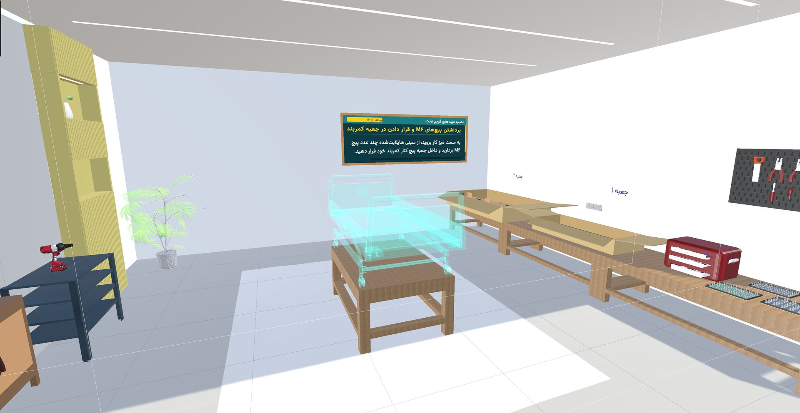](docs/media/room-overview.jpg)

</div>

<div dir="rtl">

<!--
  ویدئوی معرفی: وقتی لینک آماده شد، این بلوک را از حالت کامنت دربیاورید
  و VIDEO_URL را عوض کنید.

## 🎬 ویدئوی معرفی

[](VIDEO_URL)
-->

## 🎯 معرفی

مونتاژ تخت بیمارستانی معمولاً حضوری و با قطعات واقعی آموزش داده می‌شود. یعنی مربی لازم است، قطعه‌ها کم‌کم فرسوده می‌شوند و هر اشتباه هزینه دارد. ما همین آموزش را به واقعیت مجازی آوردیم.

با هدست Meta Quest وارد یک اتاق می‌شوید، قطعه‌ها را برمی‌دارید، روی تخت می‌گذارید، پیچ‌ها را جا می‌اندازید و با بکس برقی سفت می‌کنید. پنل روی دیوار هر مرحله را توضیح می‌دهد و کارتان را همان لحظه چک می‌کند. اگر اشتباه کنید جواب درست را نمی‌گوید و فقط یک راهنمایی می‌دهد تا خودتان پیدایش کنید.

برای تکنسین‌ها و کارگران صنعتی، بیمارستان‌ها و شرکت‌هایی که تجهیزات پزشکی تولید می‌کنند.

> Vram مخفف Virtual Reality Assembly & Maintenance است و از اسم Virtual RAM الهام گرفته.

---

## 🎞️ در عمل ببینید

<table align="center">
  <tr>
    <td align="center">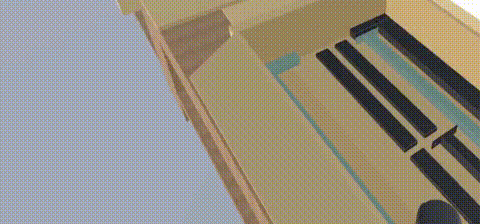<br/><sub>برداشتن قطعه از جعبه و گذاشتن در جای شفافش</sub></td>
    <td align="center">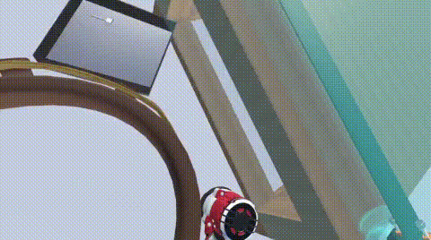<br/><sub>سفت‌کردن پیچ‌ها با بکس برقی</sub></td>
  </tr>
  <tr>
    <td align="center">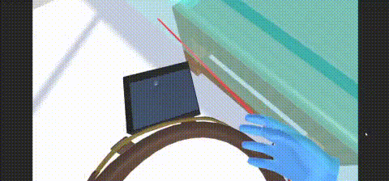<br/><sub>بکس برقی و کمربند ابزار</sub></td>
    <td align="center">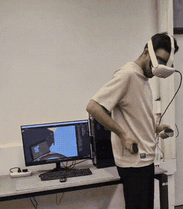<br/><sub>اجرای واقعی روی Meta Quest</sub></td>
  </tr>
</table>

---

## ✨ قابلیت‌ها

- **۶ فاز و ۵۲ مرحله.** هر مرحله فقط بعد از انجام درست مرحله‌ی قبل باز می‌شود.
- **پنل راهنما و گوینده.** هر مرحله هم نوشته می‌شود و هم خوانده می‌شود. برای کارهای تکراری (مثلاً ۴ پیچ) نوار پیشرفت هم هست.
- **هایلایت.** هرچه در مرحله‌ی فعلی لازم است رنگی می‌شود.
- **تخت شفاف.** وسط اتاق یک نسخه‌ی شفاف از تخت هست که جای هر قطعه و پیچ را نشان می‌دهد. هرچه درست نصب شود، همان‌جا واقعی می‌شود.
- **پیچ‌های چندنوعی.** هر مرحله نوع و جای مشخص پیچ را می‌خواهد.
- **بکس برقی.** با Trigger روشن می‌شود، با فشار انگشت لرزش و صدایش تغییر می‌کند و پیچ واقعاً می‌چرخد و جلو می‌رود.
- **کمربند ابزار.** بکس و جعبه‌ی پیچ روی کمربندی هستند که همراه شما حرکت می‌کند.
- **حرکت آزاد.** راه رفتن یا تلپورت.
- **همه‌چیز فارسی.** متن‌ها، پیام‌ها و گوینده.

### 🎨 معنی رنگ‌ها

| رنگ | معنی |
|:--:|---|
| 🟡 | قطعه‌ای که باید بردارید |
| 🔵 | جعبه یا جایی که باید بروید |
| 🟢 | سینی پیچِ درست |
| 🩵 | جای نصب روی تخت شفاف |

---

## 🖼️ نمایی از محیط

<table align="center">
  <tr>
    <td align="center">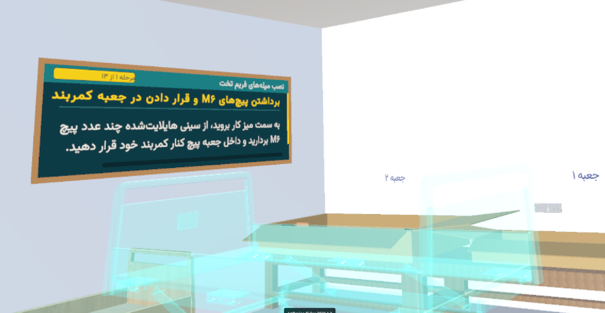<br/><sub>پنل راهنما: نام فاز، شماره‌ی مرحله و دستور</sub></td>
    <td align="center">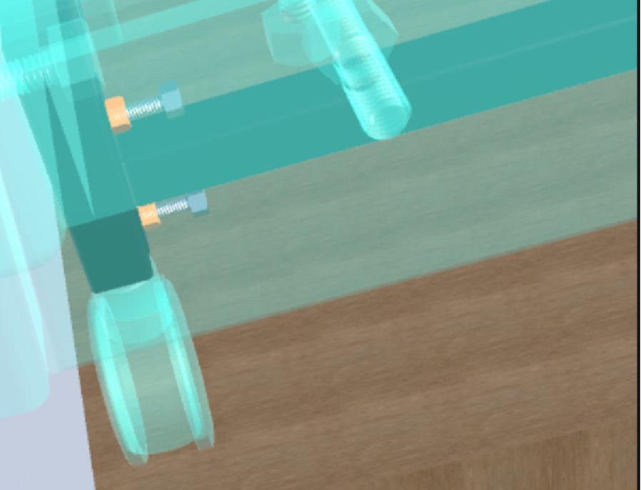<br/><sub>تخت شفاف: جای پیچ‌ها و مهره‌ها مشخص است</sub></td>
  </tr>
  <tr>
    <td align="center">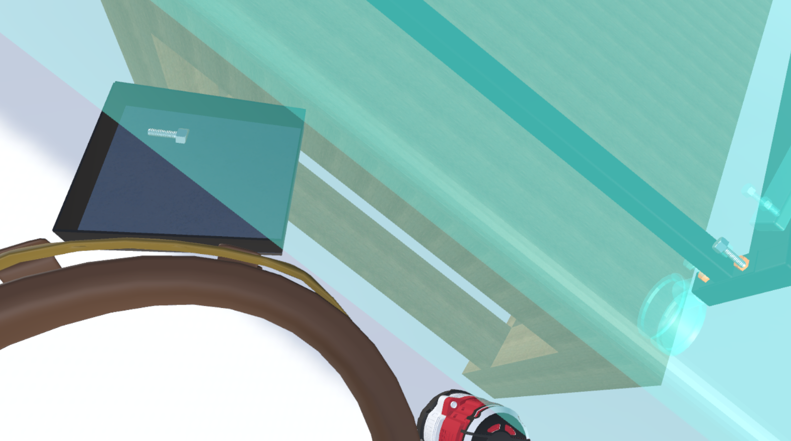<br/><sub>کمربند ابزار: جعبه‌ی پیچ و بکس برقی</sub></td>
    <td align="center">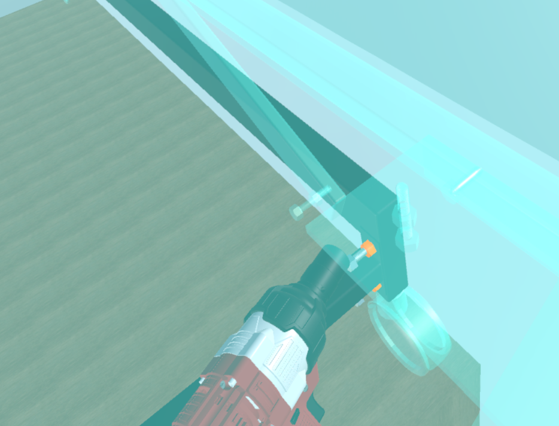<br/><sub>سفت‌کردن پیچ‌ها با بکس روی تخت شفاف</sub></td>
  </tr>
</table>

---

## 🎮 چه کارهایی انجام می‌دهید؟

| کار | توضیح |
|---|---|
| **رفتن به جعبه** | جعبه‌ای که باید بروید آبی می‌شود و با نزدیک شدن، مرحله‌ی بعد باز می‌شود. قطعه‌ها در جعبه‌ی ۱ و جعبه‌ی ۲ هستند. |
| **جمع‌کردن پیچ‌ها** | چند پیچ M6 را از سینی سبز روی میز کار برمی‌دارید و داخل جعبه‌ی پیچ کنار کمربندتان می‌ریزید. |
| **گذاشتن بکس کنار کمربند** | بکس را کنار کمربند می‌گذارید. یک نمای شفاف جای نشستنش را نشان می‌دهد و با رها کردن، خودش جا می‌افتد. |
| **نصب میله‌ها** | میله‌های فریم و چهار میله‌ی رابط را از جعبه برمی‌دارید و در جای شفافشان روی تخت می‌گذارید. |
| **نصب چرخ‌ها** | چهار چرخ، یکی‌یکی، زیر پایه‌های تخت. |
| **نصب قطعات چوبی** | قطعه‌های کناری، تاج تخت، قطعه‌ی جلویی و آخر از همه لت تخت. |
| **گذاشتن پیچ** | پیچ M6 را در جای هایلایت‌شده می‌گذارید. هر مرحله فقط همان جاها را قبول می‌کند. |
| **سفت‌کردن با بکس** | نوک بکس را روی پیچ می‌گذارید و Trigger را می‌فشارید. تا همه‌ی پیچ‌های آن مرحله جا نیفتاده باشند، بکس کار نمی‌کند. |
| **پایان** | بعد از سفت‌شدن آخرین پیچ‌های لت، پیام تبریک نشان داده می‌شود. |

<p align="center">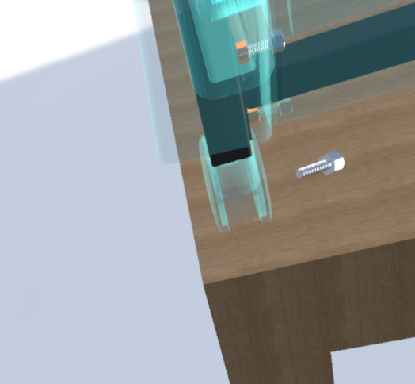<br/><sub>پیچ M6 روی میز کار، کنار تخت شفاف</sub></p>

---

## 🛏️ فازها

| فاز | چه ساخته می‌شود | مراحل |
|:--:|---|:--:|
| ۱ | فریم تخت (جلو، راست، چپ و تاج) | ۱۳ |
| ۲ | چهار میله‌ی رابط | ۱۶ |
| ۳ | چرخ‌ها | ۲ |
| ۴ | قطعات چوبی کناری | ۸ |
| ۵ | تاج و قطعه‌ی جلویی | ۸ |
| ۶ | لت تخت | ۵ |

---

## 🚨 خطاها

وقتی اشتباه می‌کنید، متن دستور چند ثانیه قرمز می‌شود و پیام راهنما را نشان می‌دهد، صدای خطا پخش می‌شود و بعد دستور اصلی برمی‌گردد. پیام‌ها عمداً جواب نمی‌دهند و فقط جهت را نشان می‌دهند.

<table align="center">
  <tr>
    <td align="center">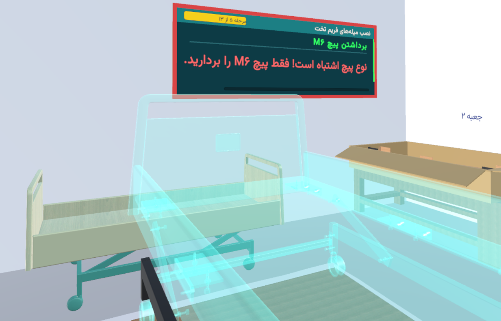<br/><sub>برداشتن پیچ از نوع اشتباه</sub></td>
    <td align="center">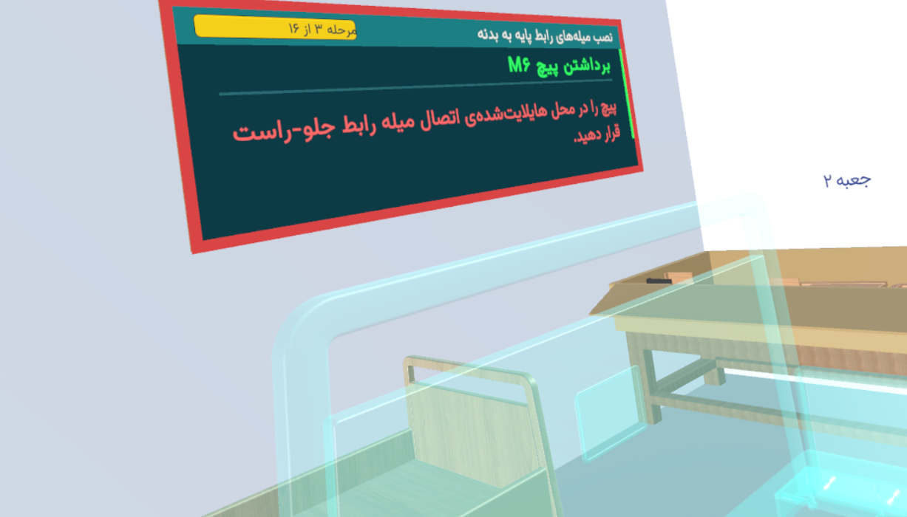<br/><sub>گذاشتن پیچ درست در جای اشتباه</sub></td>
  </tr>
</table>

| خطا | پیام |
|---|---|
| پیچ از نوع اشتباه | «نوع پیچ اشتباه است! فقط پیچ M6 را بردارید.» |
| پیچ درست، جای اشتباه | «پیچ را فقط در محل‌های هایلایت‌شده‌ی اتصال ... قرار دهید.» |
| قطعه‌ای که نوبتش نیست | «این قطعه الان مورد نیاز نیست.» (قطعه در دستتان نمی‌ماند) |
| سفت‌کردن زودتر از موعد | «ابتدا باید همه پیچ‌های این مرحله را در جای خود قرار دهید.» |
| پیچ اشتباه در جعبه‌ی کمربند | «فقط پیچ‌های M6 را داخل جعبه کمربند قرار دهید.» |

---

## 🕹️ کنترل‌ها

| کار | چطور |
|---|---|
| گرفتن قطعه | دست را نزدیک ببرید یا با اشعه نشانه بگیرید و دکمه‌ی گرفتن را بزنید |
| روشن کردن بکس | Trigger همان دستی که بکس را گرفته |
| گذاشتن بکس روی کمربند | کنار کمربند رهایش کنید |
| حرکت | راه رفتن یا تلپورت |

---

## 🧱 ساخته‌شده با

Unity، C#، XR Interaction Toolkit، مدل‌سازی با Blender و 3ds Max، و Meta Quest به‌عنوان دستگاه هدف.

---

## 🚀 اجرا

<!-- TODO: نسخه‌ی Unity، آدرس ریپو و نام صحنه‌ی اصلی را بنویسید -->

**نیازها**

- Unity (نسخه‌اش در `ProjectSettings/ProjectVersion.txt` هست) به‌همراه Android Build Support
- هدست Meta Quest و کابل Link یا Air Link
- پکیج‌های XR Interaction Toolkit، XR Plugin Management، Input System، TextMeshPro و RTLTMPro

**اجرا داخل Unity**

```bash
git clone https://github.com/YOUR_ORG/Med-Assemble.git
```

پروژه را با Unity Hub باز کنید، هدست را با Quest Link وصل کنید، صحنه‌ی اصلی را باز کنید و Play بزنید.

**نسخه‌ی نصبی روی Quest**

Build Settings را روی Android بگذارید، در XR Plug-in Management افزونه‌ی OpenXR یا Oculus را فعال کنید و Build And Run بزنید.

---

## 🧑‍💻 برای توسعه‌دهنده‌ها

کل سناریو (مرحله‌ها، متن‌ها، پیام‌های خطا، تعداد پیچ‌ها و صداها) در فایل `ScenarioSource.json` نوشته شده و با یک ابزار داخل Unity به داده‌ی پروژه تبدیل می‌شود، پس برای تغییر مرحله‌ها لازم نیست کد بزنید. روی `ScenarioManager` هم یک ابزار تست هست که در حالت Play مستقیم می‌پرد به هر فاز و مرحله.

پیام‌های Console و کامنت‌های کد را با فینگلیش می‌نویسیم، چون حروف فارسی در Console یونیتی خراب می‌شوند.

---

## 🗺️ وضعیت و برنامه‌ها

نسخه‌ی اولیه کار می‌کند و هنوز در حال توسعه و تست است. سناریوی کامل، تخت شفاف، بکس، کمربند و تشخیص خطاها آماده‌اند.

**قدم‌های بعدی**

- [ ] ثبت زمان مونتاژ
- [ ] امتیازدهی بر اساس سرعت و دقت
- [ ] گزارش عملکرد و گواهینامه
- [ ] داشبورد برای سرپرست‌ها (تحلیل خطاهای پرتکرار، سرعت و دقت کاربران)
- [ ] دمونتاژ تخت
- [ ] سناریو برای تجهیزات پزشکی دیگر

---

## 👥 تیم

| | |
|---|---|
| سرگروه | محمد مسیبی |
| عضو تیم | پریا کاظمی‌نژاد |
| عضو تیم | یکتا توکلی |

<!-- TODO: لینک GitHub/LinkedIn اعضا و ایمیل تماس را اینجا اضافه کنید -->

---

## 📄 مجوز

<!-- TODO: مجوز را انتخاب کنید و فایل LICENSE را اضافه کنید -->
هنوز تعیین نشده.

</div>
